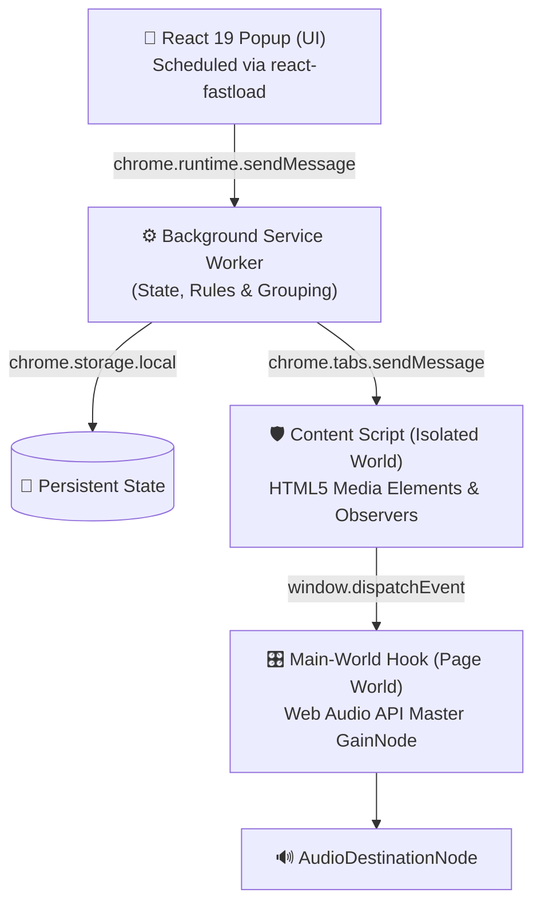

# 🎵 TabSound

> **Control, organize, and automate the sound of every browser tab.**

[](https://developer.chrome.com/docs/extensions/mv3/intro/)
[](https://react.dev/)
[](https://www.typescriptlang.org/)
[](https://vitejs.dev/)
[](https://github.com/abhishek-kumar-pundir/react-fastload)
[](LICENSE)

---

**TabSound** is a high-performance Chrome Extension (Manifest V3) that gives you full studio-grade acoustic control over your browser. Whether you have 5 or 150 tabs open, TabSound lets you independently control volume levels, mute noisy background tabs, group tabs by activity, enforce one-click Focus Modes, and seamlessly organize tabs into native Chrome Tab Groups.

Powered by [**react-fastload**](https://github.com/abhishek-kumar-pundir/react-fastload), TabSound features an adaptive resource scheduler that eliminates tab congestion and keeps the popup lightning-fast, even in tab-heavy workflows.

---

## ⚡ Highlights

- **🎚️ Precision Per-Tab Volume**: Fine-tune the audio level of any specific tab from 0% to 100% with smooth slider response, keyboard stepping, and mouse wheel scrubbing.
- **🔊 Dual Audio Interception Engine**:
  - **HTML5 Media**: Controls `<audio>` and `<video>` tags with zero delay.
  - **Web Audio API**: Injects a master `GainNode` directly into page audio contexts before `destination`, ensuring full control over advanced web apps, DAWs, Spotify Web, and HTML5 games.
- **📂 Smart Activity Categorization**: Automatically classifies tabs into 8 domains: *Entertainment*, *Music*, *Work*, *Study*, *Gaming*, *Communication*, *Social*, and *Other*.
- **🎯 One-Click Focus Modes**: Instantly apply acoustic presets (*Study*, *Gaming*, *Meeting*) that lower distractions and prioritize essential audio.
- **🔄 Drag & Drop Reclassification**: Drag tabs across categories with automated viewport autoscrolling zones and domain-level memory.
- **📑 Native Chrome Tab Groups**: Organize cluttered windows into color-coded native Chrome Tab Groups with a single click.
- **🚀 Powered by `react-fastload`**: Employs priority scheduling, deduplication, and viewport gating so tab favicons and components render efficiently without UI freezes or network bursts.
- **⌨️ Global Shortcuts**: Toggle mute for the active tab anytime via `Alt+M` (`Cmd+Shift+M` on macOS).

---

## 🏗️ Architecture & Audio Interception

Standard extensions often fail to adjust sound on websites that route audio through the Web Audio API rather than plain `<video>` or `<audio>` elements. TabSound solves this using a multi-tiered architecture:



1. **Popup UI (`src/App.tsx`)**: Built with React 19 and bundled with Vite CRX. Uses `FastLoadProvider` and `SmartImage` to schedule favicon decoding and prevent main-thread jank when listing dozens of open tabs.
2. **Service Worker (`src/background.ts`)**: Maintains persistent tab volumes, category overrides, automatic dead-tab garbage collection on tab closure, and coordinates Chrome Tab Group creation.
3. **Isolated Content Script (`src/content.ts`)**: Directly binds to `play`, `playing`, and `loadstart` media events, updating all `<audio>` and `<video>` tags with debounced mutation tracking.
4. **Main-World Hook (`src/main-world.ts`)**: Injected into the page's execution context at `document_start`. Monkey-patches `AudioNode.prototype.connect` to insert an exponential gain multiplier (`setTargetAtTime`), guaranteeing smooth volume transitions without audio clicks or popping artifacts.

---

## ⚡ Integration with `react-fastload`

TabSound integrates [**`react-fastload`**](https://github.com/abhishek-kumar-pundir/react-fastload) — an adaptive resource-loading scheduler designed for React apps.

### Why it makes TabSound better:

When users have 30, 60, or 100+ open browser tabs, rendering all tab icons simultaneously can cause heavy network bursts, favicon fetch queue contention, and layout jank.

With `react-fastload`:
- **Tiered Scheduling**:
  - `CRITICAL` + `eager`: The active tab's favicon loads immediately above the fold.
  - `HIGH`: Audible "Now Playing" tabs receive accelerated priority.
  - `NORMAL`: Categorized tabs load with managed concurrency (capped at 6 simultaneous requests).
  - `LOW`: Mass previews in the Smart Organize modal defer until scrolled into view.
- **Deduplication**: Multiple open tabs from the same origin (e.g. 10 YouTube videos or 5 GitHub repositories) share a single cached resource entry.
- **Adaptive Concurrency**: Prevents the browser extension popup thread from bottlenecking on slow connections or metered networks.

```tsx
import { FastLoadProvider, SmartImage } from 'react-fastload';

// 1. Initialized in src/main.tsx
<FastLoadProvider concurrency={6} strategy="adaptive">
  <App />
</FastLoadProvider>

// 2. Scheduled Favicons in src/App.tsx
<SmartImage
  src={currentTab.favIconUrl}
  alt=""
  className="favicon-large"
  priority="CRITICAL"
  strategy="eager"
/>
```

---

## 🎛️ Features in Detail

### 1. Active Tab Card
Displays the currently selected tab's title, origin, playing status, and a dedicated large volume slider. Includes a "Follow active tab" toggle to synchronize the card with whichever browser tab you switch to.

### 2. Now Playing HUD
An active badge and list showing every tab currently producing sound across your browser windows. Click any row to jump directly to that tab and bring its window to the foreground.

### 3. Organized Tab Groups & Master Controls
Tabs are grouped into activities:
- **Entertainment**: YouTube, Netflix, Hulu, Prime Video...
- **Music**: Spotify, SoundCloud, Apple Music...
- **Gaming**: Twitch, Discord, Cloud gaming...
- **Work**: GitHub, StackOverflow, Figma, Notion...
- **Communication**: Google Meet, Zoom, Slack, WhatsApp...
- **Study**: Coursera, Udemy, Canvas...
- **Social**: X/Twitter, Reddit, Instagram, Facebook...
- **Other**: Custom and uncategorized domains.

Each category has a **Master Group Volume Slider**. Dropping the "Social" group slider to 0% mutes all social tabs at once while maintaining individual relative offsets.

### 4. Drag & Drop Reclassification
Don't agree with a category? Grab any tab's grip handle and drop it into another category card.
- **Auto-Scrolling**: Dragging towards the top or bottom of the popup activates automatic continuous scrolling zones.
- **Domain Memory**: TabSound remembers your override for that domain for all future sessions.

### 5. Focus Modes
Quick toggle presets designed for common workflows:
| Mode | Target Volumes | Muted Categories |
| :--- | :--- | :--- |
| **Study** | Study 100%, Work 50%, Music 20% | Social, Entertainment, Gaming |
| **Gaming** | Gaming 100%, Comm 80%, Music 30% | Entertainment, Social, Study, Work |
| **Meeting** | Comm 100% | Gaming, Music, Entertainment, Social, Study, Work, Other |

### 6. Smart Organize
Click the **Organize** button in the header to preview and group your loose browser tabs into native, color-coded Chrome Tab Groups using the `chrome.tabGroups` API.

---

## ⌨️ Keyboard & Mouse Controls

- **Fine Adjustment**: Click any slider and press `Left Arrow` / `Down Arrow` (-1%) or `Right Arrow` / `Up Arrow` (+1%).
- **Large Adjustment**: Hold `Shift` with Arrow keys (±10%).
- **Mouse Wheel**: Hover over any slider and scroll up/down (±5% per notch).
- **Mute Toggle**: Press `Alt+M` (Windows/Linux) or `Cmd+Shift+M` (macOS) to instantly mute or unmute the active tab without opening the popup.

---

## 📦 Project Structure

```text
Volume/
├── manifest.json             # Manifest V3 configuration & permissions
├── vite.config.ts            # Vite build configuration with @crxjs/vite-plugin
├── package.json              # Dependencies (React 19, react-fastload, lucide-react)
├── tsconfig.json             # TypeScript configuration
├── public/                   # Static assets & icons
└── src/
    ├── main.tsx              # React entry point with FastLoadProvider
    ├── App.tsx               # Main popup UI, sliders, drag-and-drop & focus modes
    ├── App.css               # Design system, glassmorphism, animations & scroll zones
    ├── background.ts         # Service worker: storage, tab events, tabGroups API
    ├── content.ts            # Content script: HTML5 audio/video element interception
    ├── main-world.ts         # Main-world script: Web Audio API GainNode monkey-patch
    └── classifier.ts         # Domain classification rules & user override resolver
```

---

## 🚀 Getting Started

### Prerequisites
- [Node.js](https://nodejs.org/) (version 18 or newer)
- [npm](https://www.npmjs.com/) (or pnpm / yarn)
- Google Chrome, Brave, Edge, or any Chromium-based browser

### Installation

1. **Clone the repository**:
   ```bash
   git clone https://github.com/abhishek-kumar-pundir/TabSound.git
   cd TabSound
   ```

2. **Install dependencies**:
   ```bash
   npm install
   ```

3. **Start development mode** (with Hot Module Replacement):
   ```bash
   npm run dev
   ```

4. **Build the production extension**:
   ```bash
   npm run build
   ```

5. **Lint the codebase**:
   ```bash
   npm run lint
   ```

---

## 📥 Loading into Chrome

1. Open your Chromium browser and navigate to `chrome://extensions`.
2. Toggle on **Developer mode** in the top-right corner.
3. Click **Load unpacked** in the top-left corner.
4. Select the `dist` directory generated by `npm run build` (or `npm run dev`).
5. Pin **TabSound** to your browser toolbar and start managing your audio!

---

## 🛠️ Tech Stack & Dependencies

- **Frontend**: [React 19](https://react.dev/)
- **Resource Scheduler**: [react-fastload](https://github.com/abhishek-kumar-pundir/react-fastload)
- **Extension Tooling**: [@crxjs/vite-plugin](https://crxjs.dev/vite-plugin)
- **Icons**: [Lucide React](https://lucide.dev/)
- **Linter**: [Oxlint](https://oxc.rs/)
- **Bundler**: [Vite 8](https://vitejs.dev/)

---

## 📄 License

This project is licensed under the MIT License — see the [LICENSE](LICENSE) file for details.
