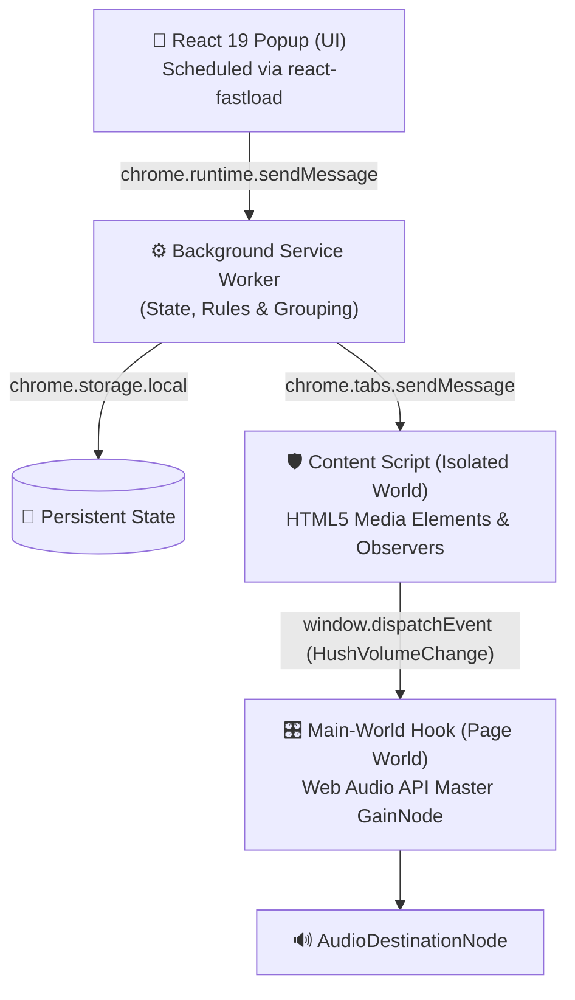
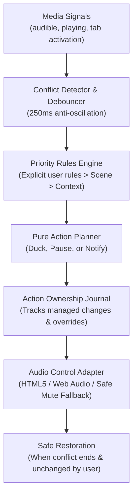

# Hush — Chrome Tab Volume Control & Audio Manager

> **A quieter browser. Control volume for individual Chrome tabs, mute noisy background tabs, manage audio across browser windows, and organize tabs into native groups.**

[](https://developer.chrome.com/docs/extensions/mv3/intro/)
[](https://react.dev/)
[](https://www.typescriptlang.org/)
[](https://vitejs.dev/)
[](https://github.com/abhishek-kumar-pundir/react-fastload)
[](LICENSE)

[**🌐 Live Website & Documentation**](https://abhishek-kumar-pundir.github.io/Hush/) • [**🔒 Privacy Policy**](https://abhishek-kumar-pundir.github.io/Hush/privacy.html) • [**📦 Installation Guide**](#-installation--loading-into-chrome)

---

## 📖 Overview

**Hush** is an open-source Chrome extension for individual tab volume control, browser audio management, and intelligent tab organization. Whether you have 5 or 150 tabs open, Hush lets you independently adjust the volume of any specific tab, instantly mute noisy background audio, organize open tabs into native color-coded Chrome Tab Groups, and enforce one-click Focus Modes.

Built with a smoky glass interface matching its translucent glass orb identity, Hush combines visual restraint with studio-grade acoustics. Powered by [**react-fastload**](https://github.com/abhishek-kumar-pundir/react-fastload), Hush schedules favicon decoding and component rendering so the interface remains silky smooth even in tab-heavy workflows.

---

## ⚡ Highlights & Verified Features

- **🎚️ Chrome Tab Volume Control**: Adjust the audio level of any specific browser tab from 0% to 100% with smooth slider response, keyboard stepping, and mouse-wheel scrubbing.
- **🔊 Dual Audio Interception Engine**:
  - **HTML5 Media**: Controls `<audio>` and `<video>` tags with zero latency.
  - **Web Audio API**: Injects a master `GainNode` directly into page audio contexts before `destination`, ensuring full control over advanced web apps, DAWs, Spotify Web, and HTML5 games without audio distortion.
- **📂 Smart Activity Categorization**: Automatically classifies tabs into 8 domains: *Entertainment*, *Music*, *Work*, *Study*, *Gaming*, *Communication*, *Social*, and *Other*.
- **🎯 One-Click Focus Modes**: Instantly apply acoustic presets (*Study*, *Gaming*, *Meeting*) with hover previews that lower distractions and prioritize essential audio.
- **🔄 Drag & Drop Reclassification**: Drag tabs across categories with automated viewport autoscrolling zones and persistent domain-level memory.
- **📑 Native Chrome Tab Groups**: Synchronizes with Chrome's native `chrome.tabGroups` API, grouping cluttered windows into color-coded groups with a single click.
- **🚀 Powered by `react-fastload`**: Employs priority scheduling, deduplication, and viewport gating so tab favicons render efficiently without UI freezes or network bursts.
- **⌨️ Global Shortcuts**: Toggle mute for the active tab anytime via `Alt+M` (`Cmd+Shift+M` on macOS).
- **🎨 Smoky Glass Product Design**: Crafted with translucent frosted glass cards (`rgba(22, 26, 36, 0.68)`), midnight gradient backdrop (`#0B0D12`), luminous periwinkle accents (`#B6B8D0`), and soft cool-mint playback indicators (`#7BE0CA`).

---

## 🏗️ Architecture & Audio Interception

Standard browser extensions often fail to adjust sound on websites that route audio through the Web Audio API rather than plain `<video>` or `<audio>` elements. Hush solves this using a multi-tier Manifest V3 pipeline:



1. **Popup UI (`src/App.tsx`)**: Built with React 19 and bundled with Vite CRX. Uses `FastLoadProvider` and `SmartImage` to schedule favicon decoding and prevent main-thread jank when listing dozens of open tabs.
2. **Service Worker (`src/background.ts`)**: Maintains persistent tab volumes, category overrides, automatic dead-tab garbage collection on tab closure, and coordinates Chrome Tab Group creation.
3. **Isolated Content Script (`src/content.ts`)**: Directly binds to `play`, `playing`, and `loadstart` media events, updating all `<audio>` and `<video>` tags with debounced mutation tracking.
4. **Main-World Hook (`src/main-world.ts`)**: Injected into the page's execution context at `document_start`. Monkey-patches `AudioNode.prototype.connect` to insert an exponential gain multiplier (`setTargetAtTime`), guaranteeing smooth volume transitions without audio clicks or popping artifacts.

---

## ⚡ Integration with `react-fastload`

Hush integrates [**`react-fastload`**](https://github.com/abhishek-kumar-pundir/react-fastload) — an adaptive resource-loading scheduler designed for React apps.

### Why it makes Hush better:

When users have 30, 60, or 100+ open browser tabs, rendering all tab icons simultaneously can cause heavy network bursts, favicon fetch queue contention, and layout jank.

With `react-fastload`:
- **Tiered Scheduling**:
  - `CRITICAL` + `eager`: The active tab's favicon loads immediately above the fold.
  - `HIGH`: Audible "Now Playing" tabs receive accelerated priority.
  - `NORMAL`: Categorized tabs load with managed concurrency (capped at 6 simultaneous requests).
  - `LOW`: Mass previews in the Smart Organize modal defer until scrolled into view.
- **Deduplication**: Multiple open tabs from the same origin (e.g., 10 YouTube videos or 5 GitHub repositories) share a single cached resource entry.
- **Adaptive Concurrency**: Prevents the browser extension popup thread from bottlenecking on slow connections or metered networks.

```tsx
import { FastLoadProvider, SmartImage } from 'react-fastload';

// 1. Initialized in src/main.tsx
<FastLoadProvider concurrency={6} strategy="adaptive">
  <App />
</FastLoadProvider>

// 2. Scheduled Favicons in src/App.tsx
<SmartImage
  src={currentTab.favIconUrl}
  alt=""
  className="favicon-large"
  priority="CRITICAL"
  strategy="eager"
/>
```

---

## 🎛️ Detailed Features

### 1. Active Tab Card
Displays the currently selected tab's title, domain, playing status, and a dedicated large volume slider. Includes a "Follow active tab" toggle to synchronize the card with whichever browser tab you switch to.

### 2. Now Playing HUD
An active list showing every tab currently producing sound across your browser windows. Click any row to jump directly to that tab and bring its window to the foreground.

### 3. Organized Tab Groups & Master Controls
Tabs are grouped into activities:
- **Entertainment**: YouTube, Netflix, Hulu, Prime Video...
- **Music**: Spotify, SoundCloud, Apple Music...
- **Gaming**: Twitch, Discord, Cloud gaming...
- **Work**: GitHub, StackOverflow, Figma, Notion...
- **Communication**: Google Meet, Zoom, Slack, WhatsApp...
- **Study**: Coursera, Udemy, Canvas...
- **Social**: X/Twitter, Reddit, Instagram, Facebook...
- **Other**: Custom and uncategorized domains.

Each category has a **Master Group Volume Slider**. Dropping the "Social" group slider to 0% mutes all social tabs at once while maintaining individual relative offsets.

### 4. Drag & Drop Reclassification
Don't agree with a category? Grab any tab's grip handle and drop it into another category card.
- **Auto-Scrolling**: Dragging towards the top or bottom of the popup activates automatic continuous scrolling zones.
- **Domain Memory**: Hush remembers your override for that domain for all future sessions.

### 5. Focus Modes
Quick toggle presets designed for common workflows:

| Mode | Target Volumes | Muted Categories |
| :--- | :--- | :--- |
| **Study** | Study 100%, Work 50%, Music 20% | Social, Entertainment, Gaming |
| **Gaming** | Gaming 100%, Comm 80%, Music 30% | Entertainment, Social, Study, Work |
| **Meeting** | Comm 100% | Gaming, Music, Entertainment, Social, Study, Work, Other |

Hovering over any Focus Mode button displays a live popover listing open tabs that will be active or muted in that preset.

### 6. Intelligent Audio Priority (Local Sound Intelligence)

Hush includes a local-first browser audio coordination engine that automatically manages competing audio sources without cloud services or external AI APIs:



#### Strict Rule Precedence:
1. **Global Automation Disabled**: Respects user's master toggle.
2. **Explicit Manual Overrides & Exclusions**: A manually adjusted or pinned tab is never automatically interfered with. Excluded domains are immune to automatic ducking.
3. **Explicit Domain Priorities**: User-configured priorities (0–100) take precedence over scene defaults.
4. **Active Scene Rules**: Domain and category priorities defined by the currently active scene.
5. **Contextual Signals**: Foreground active tab bonus (+5) and natural activity weighting.
6. **Deterministic Tie-Breaking**: Earliest audible timestamp, followed by tab ID fallback.

#### Audio Scenes:
- **Deep Work**: Prioritizes communication (Zoom, Google Meet, Slack) and suppresses background music, videos, and social audio.
- **Study**: Prioritizes lectures and educational media (Coursera, Udemy, Khan Academy) while ducking ambient music.
- **Entertainment**: Gives focus to active video and media streams.
- **Custom**: Fully user-tailored domain priorities and ducking behavior.

#### Safe Action Ownership & Restoration:
- **Action Journal**: Every automated ducking action records the tab's navigation identity, pre-conflict baseline volume, and extension ownership.
- **User Change Immunity**: If you manually move a slider on a ducked tab, Hush relinquishes ownership and will **never** overwrite your chosen volume when the conflict finishes.
- **Navigation Safety**: If a ducked tab navigates to a new URL, the old action is invalidated to avoid restoring unrelated content.
- **Pre-Mute Respect**: Tabs muted before Hush intervened are never unmuted automatically.

#### Control Adapters & Technical Limitations:
- **HTML5 Media**: Smooth volume adjustment down to target ducking level (default 25%).
- **Web Audio**: Injected `GainNode` support.
- **Safe Fallback**: On restricted or cross-origin frames where programmatic volume adjustment is blocked by browser security, Hush utilizes native tab muting as a truthful fallback rather than claiming volume reduction.
- **Restricted Domains**: Extensions cannot inject into `chrome://` or Chrome Web Store pages.

#### Local Contextual Learning:
- Identifies repeated patterns (e.g., lowering a specific domain 3 times during Study mode).
- Proposes concise, dismissible suggestions ("Make this your default rule?").
- Operates 100% locally with zero analytics, zero telemetry, and a one-click "Clear Learned Rules" action.

### 7. Smart Organize
Click the **Organize tabs** button in the header to preview and group your loose browser tabs into native, color-coded Chrome Tab Groups using the `chrome.tabGroups` API.

---

## ⌨️ Keyboard & Mouse Controls

| Action | Windows & Linux | macOS | Description |
| :--- | :--- | :--- | :--- |
| **Mute Active Tab** | `Alt + M` | `Cmd + Shift + M` | Instantly mute/unmute the active tab without opening the popup. |
| **Fine Volume Step** | `←` / `→` (or `↓` / `↑`) | `←` / `→` (or `↓` / `↑`) | Adjust focused volume slider by ±1%. |
| **Large Volume Step** | `Shift + Arrow` | `Shift + Arrow` | Adjust focused volume slider by ±10%. |
| **Mouse Wheel Scrub**| `Wheel Up / Down` | `Wheel Up / Down` | Hover over any slider to adjust by ±5%. |

---

## 🔒 Permissions & Security

Hush requests only the permissions strictly required to provide individual tab volume control and tab organization:

- **`tabs`**: Used to read tab titles, favicons, and audible status to present them in the popup, and to focus a specific tab when clicked in the Now Playing HUD.
- **`storage`**: Used to persist your volume settings and custom category overrides locally on your device via `chrome.storage.local`.
- **`tabGroups`**: Used strictly when you click "Organize tabs" to bundle loose browser tabs into native, color-coded Chrome Tab Groups.

**Privacy Guarantee**: Hush operates 100% client-side. No personal data, browsing history, audio samples, or telemetry is ever collected, stored on remote servers, or transmitted. See our [Privacy Policy](https://abhishek-kumar-pundir.github.io/Hush/privacy.html) for details.

---

## 📥 Installation & Loading into Chrome

### Prerequisites
- [Node.js](https://nodejs.org/) (version 18 or newer)
- [npm](https://www.npmjs.com/) (or pnpm / yarn)
- Google Chrome, Brave, Microsoft Edge, or any Chromium-based browser

### Build from Source

1. **Clone the repository**:
   ```bash
   git clone https://github.com/abhishek-kumar-pundir/Hush.git
   cd Hush
   ```

2. **Install dependencies**:
   ```bash
   npm install
   ```

3. **Start development mode** (with Hot Module Replacement):
   ```bash
   npm run dev
   ```

4. **Build the production extension**:
   ```bash
   npm run build
   ```

5. **Lint the codebase**:
   ```bash
   npm run lint
   ```

### Load Unpacked into Chrome

1. Open your Chromium browser and navigate to `chrome://extensions`.
2. Toggle on **Developer mode** in the top-right corner.
3. Click **Load unpacked** in the top-left corner.
4. Select the `dist` directory generated by `npm run build`.
5. Pin **Hush** to your browser toolbar for quick access!

---

## 🏷️ Suggested GitHub Repository Topics

To maximize discoverability on GitHub, add these topics to your repository settings (`About` → `⚙️ Topics`):

```text
chrome-extension, audio-control, tab-volume, tab-volume-control, audio-manager, web-audio-api, tab-groups, react19, vite, typescript, manifest-v3, productivity, focus-tool
```

---

## 🛠️ Tech Stack & Dependencies

- **Frontend**: [React 19](https://react.dev/)
- **Typography**: [Inter (@fontsource/inter)](https://fontsource.org/fonts/inter)
- **Resource Scheduler**: [react-fastload](https://github.com/abhishek-kumar-pundir/react-fastload)
- **Extension Tooling**: [@crxjs/vite-plugin](https://crxjs.dev/vite-plugin)
- **Icons**: [Lucide React](https://lucide.dev/)
- **Linter**: [Oxlint](https://oxc.rs/)
- **Bundler**: [Vite 8](https://vitejs.dev/)

---

## 📄 License

This project is licensed under the MIT License — see the [LICENSE](LICENSE) file for details.
