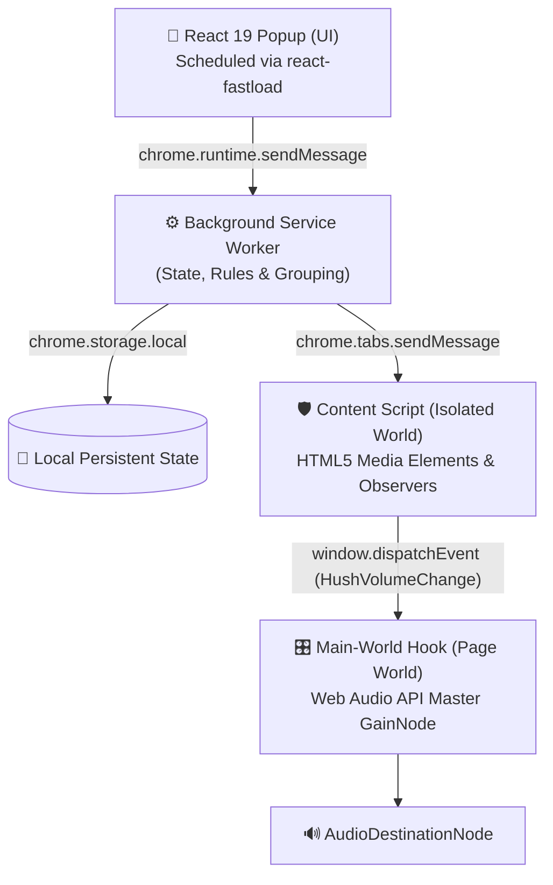

<p align="center">
  
</p>

<h1 align="center">Hush</h1>

<p align="center">
  <b>Your browser's audio, under control.</b><br/>
  Per-tab volume control, automatic local audio coordination, and intelligent workspace organization for Chromium browsers.
</p>

<p align="center">
  <a href="https://developer.chrome.com/docs/extensions/mv3/intro/"></a>
  <a href="https://react.dev/"></a>
  <a href="https://www.typescriptlang.org/"></a>
  <a href="https://vitejs.dev/"></a>
  <a href="https://github.com/abhishek-kumar-pundir/react-fastload"></a>
  <a href="LICENSE"></a>
  
</p>

<p align="center">
  <a href="#-screenshots">Screenshots</a> •
  <a href="#-feature-overview">Features</a> •
  <a href="#-how-it-works">Architecture</a> •
  <a href="#-installation">Installation</a> •
  <a href="#-usage-guide">Usage Guide</a> •
  <a href="docs/privacy.html">Privacy Policy</a>
</p>

---

## 📖 Overview

**Hush** is an open-source Chrome extension engineered to solve browser audio chaos. Whether you have 5 or 50 tabs open, Hush provides independent, per-tab volume adjustment, local intelligent audio ducking across competing sources, native tab muting, and single-click tab organization into native Chrome Tab Groups.

Built with a smoky glass interface matching its translucent orb visual identity, Hush operates with a **strict client-side privacy architecture**: zero audio streams, browsing history, or personal data leave your device.

---

## 📸 Screenshots

<table align="center">
  <tr>
    <td align="center" width="50%">
      <br />
      <b>Audio Mixer Dashboard</b><br />
      <sub>Active tab slider, Now Playing HUD, and category mixers</sub>
    </td>
    <td align="center" width="50%">
      <br />
      <b>Audio Intelligence & Scenes</b><br />
      <sub>Acoustic scenes, conflict response, and ducking presets</sub>
    </td>
  </tr>
  <tr>
    <td align="center" width="50%">
      <br />
      <b>Site Priorities & Exclusions</b><br />
      <sub>Protected domain list, custom scores, and local rules</sub>
    </td>
    <td align="center" width="50%">
      <br />
      <b>Smart Organize Tabs</b><br />
      <sub>Interactive grouping preview and Chrome Tab Groups sync</sub>
    </td>
  </tr>
</table>

---

## ✨ Feature Overview

### 🎚️ Precision Per-Tab Volume Control
- **Independent Tab Volume (0%–100%)**: Adjust any specific tab's volume without altering system volume or other tabs.
- **Micro-Stepping**: Click any slider to adjust by ±1% using keyboard arrow keys, or ±10% with `Shift + Arrow`.
- **Mouse-Wheel Scrubbing**: Hover over any volume slider and scroll to increase or decrease volume by 5%.
- **Active Tab Mute Toggle**: Quickly toggle tab mute state directly in the popup or with global shortcut `Alt+M` (`Cmd+Shift+M` on macOS).

### 🔊 Dual-Engine Audio Interception
- **HTML5 Media**: Directly controls standard `<audio>` and `<video>` tags with zero latency.
- **Web Audio API**: Injects a master `GainNode` directly into page audio contexts before `destination`, ensuring full volume scaling over complex web audio apps, DAWs, Spotify Web, and HTML5 games without audio distortion or popping.

### 🧠 Intelligent Audio Priority (Local Sound Intelligence)
- **Automatic Conflict Detection**: Detects when background audio competes with your active foreground work with a 250ms anti-oscillation debouncer.
- **4 Selectable Acoustic Scenes**:
  - **Deep Work**: Prioritizes communication (Zoom, Google Meet, Slack) and automatically suppresses background entertainment.
  - **Study**: Prioritizes educational media and lectures (Coursera, Udemy) while ducking ambient music.
  - **Entertainment**: Focuses on active video and stream audio.
  - **Custom**: Tailored rules based on your configured domain priorities.
- **Conflict Response Modes**: Choose between *Duck audio*, *Pause media*, or *Notify only*.
- **Background Ducking Presets**: Switch between *Subtle (40%)*, *Balanced (25%)*, and *Whisper (10%)*.
- **Action Ownership Journal**: Remembers pre-conflict baseline volumes and restores tabs when conflicts end. If you manually adjust a ducked slider, Hush relinquishes ownership and will **never** overwrite your chosen volume.
- **Protected Domains**: Sites added to your protected list are completely immune to automatic volume reduction or pausing.
- **Custom Site Priorities**: Assign specific priority scores (10–90) to domains that should always take precedence.
- **Local Heuristic Learning**: Suggests domain priority rules when you repeatedly adjust volume for a domain, running 100% locally with a one-click "Clear Learned Rules" action.

### 📂 Smart Tab Organization & Chrome Tab Groups
- **Deterministic Classification**: Categorizes open tabs into 8 domains: *Entertainment*, *Music*, *Work*, *Study*, *Gaming*, *Communication*, *Social*, and *Other*.
- **Native Chrome Tab Groups**: Synchronizes with the `chrome.tabGroups` API to bundle cluttered tabs into color-coded browser tab groups.
- **Drag-and-Drop Reclassification**: Move tabs between categories with automated continuous viewport autoscrolling. Overrides are remembered persistently for future sessions.
- **Category Master Sliders**: Lower or mute an entire category (e.g., mute all Social tabs) while preserving individual relative volume offsets.
- **One-Click Focus Presets**: Instantly apply acoustic presets (*Study*, *Gaming*, *Meeting*) with live hover previews.

---

## 🏗️ How It Works

Hush uses a multi-tier Manifest V3 pipeline combining isolated content scripts and a page-world Web Audio hook:



1. **Popup UI (`src/App.tsx`)**: Built with React 19 and compiled with Vite. Utilizes `react-fastload` to schedule favicon decoding and prevent main-thread jank when listing large numbers of open tabs.
2. **Service Worker (`src/background.ts`)**: Maintains persistent volume settings, manages dead-tab garbage collection on tab close, coordinates Chrome Tab Groups, and hosts the Intelligent Audio Priority Coordinator (`src/priority/`).
3. **Isolated Content Script (`src/content.ts`)**: Binds to HTML5 `play`, `playing`, and `loadstart` media events, updating `<audio>` and `<video>` tags with debounced mutation tracking.
4. **Main-World Hook (`src/main-world.ts`)**: Injected into the page's execution context at `document_start`. Hooks `AudioNode.prototype.connect` to insert an exponential gain multiplier (`setTargetAtTime`), guaranteeing smooth volume transitions without audio clicks or popping artifacts.

---

## 📥 Installation

### Option 1: Chrome Web Store (Recommended)
> **Status**: *Currently submitted and awaiting review in the Chrome Web Store.*  
> Direct installation link will be published here as soon as review completes.

### Option 2: Developer Installation (Load Unpacked)

1. **Clone the repository**:
   ```bash
   git clone https://github.com/abhishek-kumar-pundir/Hush.git
   cd Hush
   ```

2. **Install dependencies**:
   ```bash
   npm install
   ```

3. **Build the extension**:
   ```bash
   npm run build
   ```
   *(This compiles all TypeScript source files into the production bundle in the `dist` directory).*

4. **Load into your Chromium browser**:
   - Open Chrome, Brave, Edge, or any Chromium browser and navigate to `chrome://extensions`.
   - Enable **Developer mode** in the top-right corner.
   - Click **Load unpacked** in the top-left corner.
   - Select the **`dist`** directory inside the cloned `Hush` repository.
   - Pin **Hush** to your toolbar for instant access.

---

## 🕹️ Usage Guide

### Adjusting Volume
- **Active Tab**: Open the popup. The top card shows the active tab with a large slider.
- **Any Tab**: Scroll down to the categorized tab list and adjust any individual slider.
- **Fine Control**: Click a slider and use the `←` / `→` arrow keys (1% step) or `Shift + Arrow` (10% step).
- **Mouse-Wheel Scrubbing**: Hover over any slider and scroll your mouse wheel up or down.

### Muting & Unmuting
- Click the **Mute** button on the Active Tab card.
- Or use the global keyboard shortcut: `Alt + M` (`Cmd + Shift + M` on macOS).

### Audio Intelligence & Scenes
1. In the popup, locate the **Sound Intelligence** card and click **Settings**.
2. Toggle **Auto-manage audio** on or off.
3. Select an **Acoustic Scene** (*Deep Work*, *Study*, *Entertainment*, *Custom*).
4. Choose a default conflict response (*Duck audio*, *Pause media*, *Notify only*) and pick a ducking percentage preset.

### Setting Protected Sites & Domain Priorities
1. In Audio Intelligence settings, navigate to **Priority Rules & Exclusions**.
2. **Protected sites**: Enter a domain (e.g., `zoom.us`) and click **Add** to prevent it from ever being ducked or paused.
3. **Site priorities**: Enter a domain (e.g., `spotify.com`), pick a priority level (e.g., `High (80)`), and click **Add**.

### Organizing Tabs into Groups
- Click **Organize tabs** in the top header.
- Review proposed groups, filter tabs by search query, or drag tabs between categories.
- Click **Apply Groups** to create native Chrome Tab Groups.

---

## 🛠️ Technology Stack

- **Framework**: [React 19](https://react.dev/)
- **Language**: [TypeScript](https://www.typescriptlang.org/)
- **Build System**: [Vite 8](https://vitejs.dev/) with [@crxjs/vite-plugin](https://crxjs.dev/vite-plugin)
- **Design & Typography**: Vanilla CSS with [Inter (@fontsource/inter)](https://fontsource.org/fonts/inter)
- **Icons**: [Lucide React](https://lucide.dev/)
- **Resource Scheduler**: [react-fastload](https://github.com/abhishek-kumar-pundir/react-fastload)
- **Unit Testing**: [Vitest](https://vitest.dev/)
- **Linter**: [Oxlint](https://oxc.rs/)

---

## 🔒 Permissions & Privacy

Hush requests only the permissions strictly required to provide individual tab volume control, audio ducking, and tab organization:

| Permission | Purpose in Hush |
| :--- | :--- |
| **`tabs`** | Reads tab titles, URLs, favicons, and audible status to display active media in the popup mixer and update volume. |
| **`storage`** | Saves volume levels, acoustic scenes, custom site priorities, and category overrides locally in `chrome.storage.local`. |
| **`tabGroups`** | Creates, updates, and colors native Chrome Tab Groups when clicking "Organize tabs". |
| **`<all_urls>`** *(Content Scripts)* | Injects media hooks to adjust HTML5 `<audio>`/`<video>` volume and Web Audio gain nodes across any website where audio plays. |

### Privacy Architecture
- **100% Local Execution**: Hush makes **zero external network requests** (`fetch`, `XMLHttpRequest`, or `WebSocket`).
- **No Telemetry or Tracking**: No analytics libraries, error trackers, or third-party SDKs are bundled.
- **No Audio Recording**: Audio data is never recorded, captured, or analyzed; only volume gain values are modified.
- **Data Persistence**: Preferences are saved locally on your device via `chrome.storage.local`.
- Read the complete [Privacy Policy](docs/privacy.html).

---

## ⚠️ Technical Limitations

- **Browser-Restricted Pages**: Chrome security policy prevents extensions from executing content scripts on internal browser URLs (`chrome://*`, `chrome-extension://*`, and the Chrome Web Store). Volume on these tabs cannot be adjusted.
- **Cross-Origin Iframes**: When media is embedded inside heavily restricted cross-origin iframes without parent script access, programmatic volume scaling may be blocked by browser sandbox boundaries. In these scenarios, Hush falls back to native tab muting.
- **Pure Native Plugins**: Media rendered through proprietary native plugins that bypass standard HTML5 `<audio>`/`<video>` elements and Web Audio API contexts cannot be scaled incrementally, but can still be muted via native tab muting.

---

## 📂 Project Structure

```text
Hush/
├── docs/                       # Documentation, privacy policy & assets
│   ├── screenshots/            # Verified interface screenshots
│   │   ├── dashboard.png
│   │   ├── audio-intelligence.png
│   │   ├── priority-rules.png
│   │   └── organize-tabs.png
│   ├── CHROME_WEB_STORE_LISTING.md # Store metadata & justifications
│   ├── privacy.html            # Static privacy policy
│   └── index.html              # Documentation home
├── public/                     # Static extension icons and manifest assets
│   ├── icon-16.png
│   ├── icon-32.png
│   ├── icon-48.png
│   └── icon-128.png
├── src/                        # Extension source code
│   ├── components/             # React components
│   │   ├── AudioIntelligenceSettings.tsx # Settings view & rules
│   │   ├── OrganizeTabsWorkspace.tsx     # Tab grouping workspace
│   │   └── SoundIntelligenceCard.tsx     # Dashboard status card
│   ├── priority/               # Intelligent Audio Priority engine
│   │   ├── action-journal.ts   # Ownership tracking & baseline restoration
│   │   ├── action-planner.ts   # Pure action calculation
│   │   ├── adapters.ts         # Audio control adapter interfaces
│   │   ├── conflict-detector.ts # Multi-source conflict detection
│   │   ├── coordinator.ts      # Coordination & state persistence
│   │   ├── priority-engine.ts  # Priority score evaluation
│   │   ├── scenes.ts           # Acoustic scene definitions
│   │   ├── suggestion-engine.ts # Local heuristic proposals
│   │   └── types.ts            # Priority system types
│   ├── App.css                 # Smoky glass design system & component styles
│   ├── App.tsx                 # Main popup mixer interface
│   ├── background.ts           # Manifest V3 service worker
│   ├── classifier.ts           # Deterministic domain classifier
│   ├── content.ts              # Isolated-world HTML5 media observer
│   ├── index.css               # Design tokens & color-scheme resets
│   ├── main-world.ts           # Page-world Web Audio API GainNode hook
│   └── main.tsx                # React entry point with react-fastload
├── manifest.json               # Chrome Extension Manifest V3 configuration
├── package.json                # Project dependencies & scripts
├── vite.config.ts              # Vite + CRXJS build configuration
├── CHANGELOG.md                # Release changelog
├── CONTRIBUTING.md             # Contributor guidelines
└── LICENSE                     # MIT License
```

---

## 🧪 Development & Testing

### Available Commands

| Command | Action |
| :--- | :--- |
| `npm install` | Install all dependencies |
| `npm run dev` | Start Vite dev server with Hot Module Replacement |
| `npm test` | Run Vitest unit test suite |
| `npm run lint` | Run Oxlint fast linter across source files |
| `npx tsc -b --noEmit` | Run TypeScript compiler type checking |
| `npm run build` | Build production extension bundle into `dist/` |

### Verified Test Results
```text
✓ src/priority/__tests__/priority.test.ts (20 tests passed)
✓ oxlint: 0 errors reported in src/
✓ tsc: 0 type errors
✓ vite build: successfully generated bundle in 1.2s
```

---

## 🤝 Contributing

Contributions, bug reports, and suggestions are welcome! Please review [CONTRIBUTING.md](CONTRIBUTING.md) for details on opening issues, architectural guidelines, and the pull request workflow.

---

## 📄 License

This project is open-source and licensed under the [MIT License](LICENSE) © 2026 Abhishek Kumar Pundir.

---

## 🗺️ Project Status & Roadmap

- [x] **v1.0.0 (Current)**:
  - Per-tab volume control (0%–100%) and native tab muting.
  - HTML5 and Web Audio API dual-engine interception.
  - Intelligent Audio Priority with 4 Acoustic Scenes and conflict ducking.
  - Native Chrome Tab Groups integration with auto-categorization.
  - Complete client-side privacy with `chrome.storage.local` persistence.
  - Submitted for Chrome Web Store review.
- [ ] **Planned**:
  - Custom user-defined acoustic scene creation.
  - Per-tab equalizer curves (bass boost, vocal clarity).
  - Configurable hotkeys for individual category muting.
